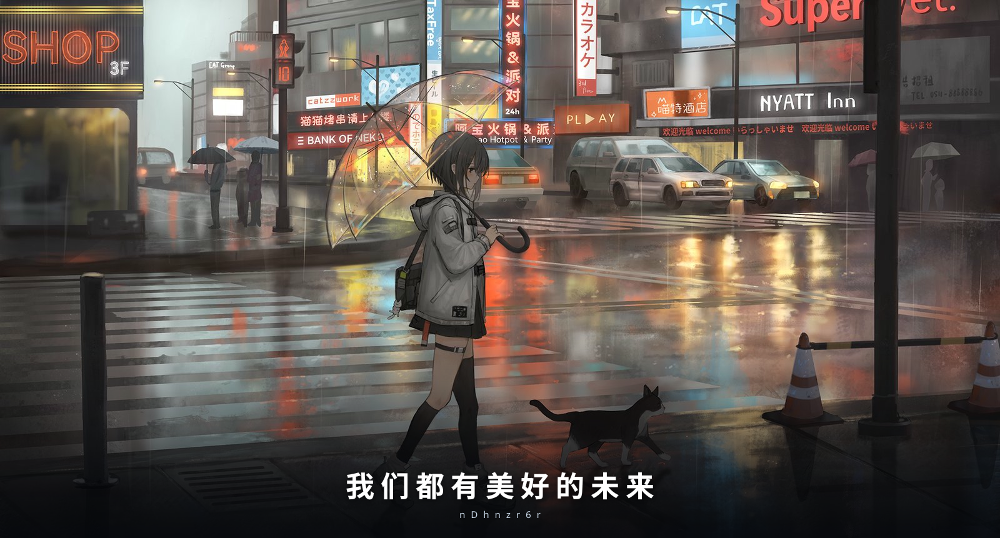

## 你好，我是 nDhnzr6r 👋

紫水晶学习小组。2019 年开始写代码，最初只是想给自己的问题找点解法，后来发现写程序这件事本身就足够有趣——把重复的麻烦变成一行命令，把模糊的想法变成别人打开就能用的东西。

我做的多数东西都遵循同一套原则：不依赖复杂的环境，打开就能用；数据尽量留在本地；文档写得比代码还认真。技术上没有敢称精通的语言，但遇到不会的东西，愿意花时间把它弄明白。

> 我们都有美好的未来。

## 现在在做什么

- 🔭 给自己和同学写小工具，比如成绩记录、游戏资源的下载助手
- 🌱 在学 AI 工具的使用与配置，试着把它们接进日常的编程流程
- 📖 读英文技术文档，把看过的东西整理成能看懂的笔记
- 💬 帮别人解决 GitHub 与开源项目的使用问题

## 语言与工具

  
  
  
  
  
  
  

## 找到我

- 站点：<https://nDhnzr6r.com>
- GitHub：<https://github.com/nDhnzr6r>
- 有问题欢迎在对应项目里提议题
